

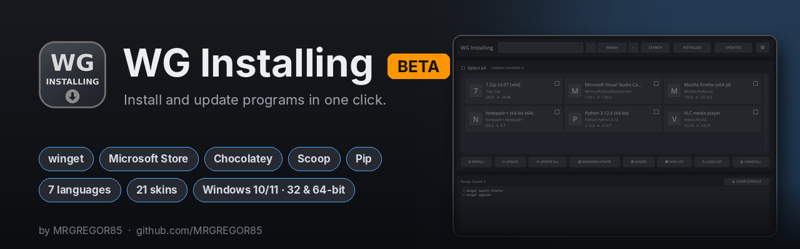

## [🇵🇱 Polski](../README_PL.md) &nbsp; [🇬🇧 English](../README.md) &nbsp; [🇩🇪 Deutsch](README_DE.md) &nbsp; [🇨🇿 Čeština](README_CS.md) &nbsp; [🇸🇰 Slovenčina](README_SK.md) &nbsp; [🇺🇦 Українська](README_UK.md) &nbsp; [🇷🇺 Русский](README_RU.md) &nbsp; [🇱🇹 Lietuvių](README_LT.md) &nbsp; [🇱🇻 Latviešu](README_LV.md) &nbsp; [🇪🇪 Eesti](README_ET.md) &nbsp; [🇪🇸 Español](README_ES.md) &nbsp; [🇫🇷 Français](README_FR.md) &nbsp; [🇮🇹 Italiano](README_IT.md) &nbsp; [🇵🇹 Português](README_PT.md) &nbsp; [🇳🇱 Nederlands](README_NL.md) &nbsp; [🇸🇪 Svenska](README_SV.md) &nbsp; [🇩🇰 Dansk](README_DA.md) &nbsp; [🇳🇴 Norsk](README_NO.md) &nbsp; [🇫🇮 Suomi](README_FI.md) &nbsp; [🇭🇺 Magyar](README_HU.md) &nbsp; [🇷🇴 Română](README_RO.md) &nbsp; [🇧🇬 Български](README_BG.md) &nbsp; [🇬🇷 Ελληνικά](README_EL.md) &nbsp; [🇭🇷 Hrvatski](README_HR.md) &nbsp; [🇷🇸 Српски](README_SR.md) &nbsp; [🇸🇮 Slovenščina](README_SL.md) &nbsp; [🇹🇷 Türkçe](README_TR.md) &nbsp; [🇻🇳 Tiếng Việt](README_VI.md) &nbsp; [🇮🇩 Indonesia](README_ID.md)

 

### Al je Windows-programma's in één venster.
Programma's zoeken, installeren, bijwerken en verwijderen met één klik. Geen opdrachten typen.

 

Windows 10 en 11 · 32- en 64-bit · één bestand, niets te installeren

  

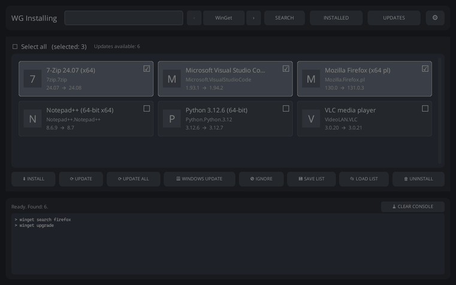

 

## Wat het doet

| Functie | Wat het betekent |
|---|---|
| **Zoeken en installeren** | Typ een naam, vink de programma's aan, klik op **INSTALL**. Meerdere tegelijk. |
| **Alles bijwerken** | Eén klik op **UPDATE ALL** houdt al je programma's up-to-date. |
| **Slim bijwerken** | Blokkeert een open programma een update, dan wordt het gesloten en daarna weer geopend. |
| **Verwijderen** | Verwijder programma's die je niet meer nodig hebt. |
| **Windows Update** | Bekijk wachtende Windows-updates en installeer ze. |
| **7 bronnen** | WinGet, Microsoft Store, PowerShell Gallery, Pip, Chocolatey, Scoop en Ninite. |
| **Verhuizen naar een nieuwe pc** | Sla je programmalijst op en installeer alles op een andere computer. |
| **Jouw stijl** | 7 talen en 21 kleurthema's. |
| **Privé** | Geen reclame, geen tracking, geen account. |

## Schermafbeeldingen

<table>
<tr>
<td width="50%">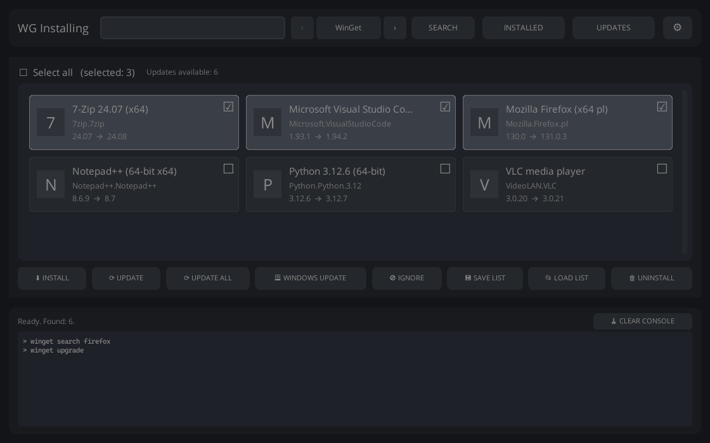</td>
<td width="50%">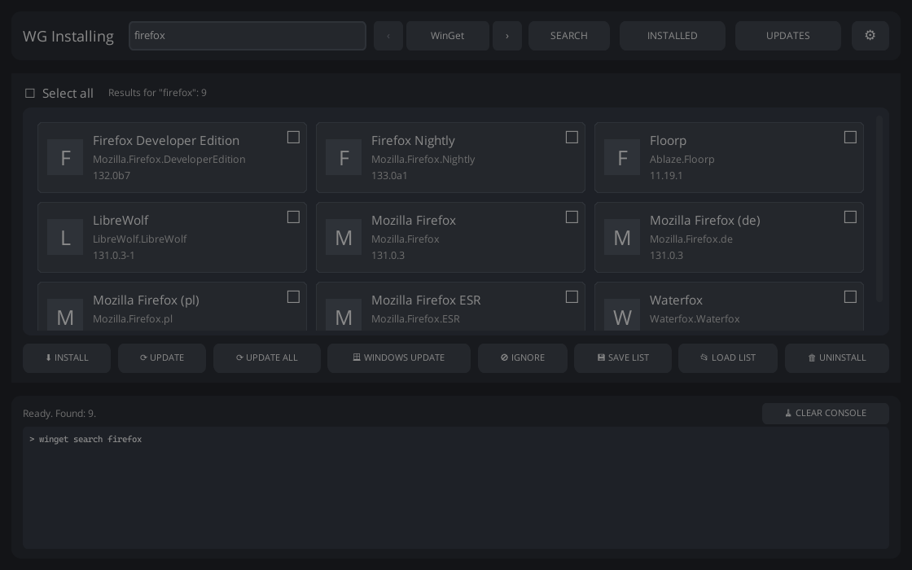</td>
</tr>
<tr>
<td align="center"><b>Updates</b></td>
<td align="center"><b>Zoeken en installeren</b></td>
</tr>
<tr>
<td>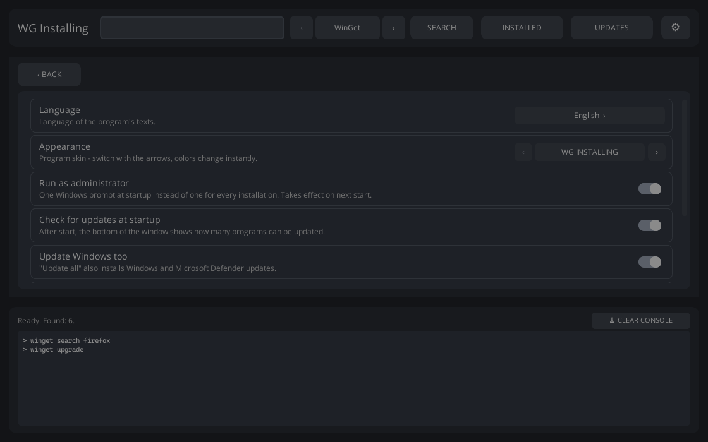</td>
<td>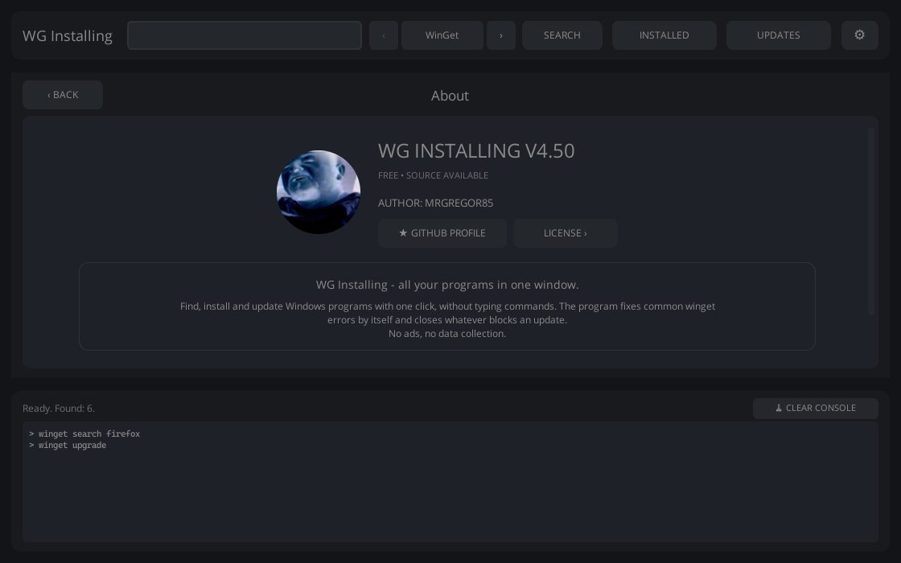</td>
</tr>
<tr>
<td align="center"><b>Instellingen</b></td>
<td align="center"><b>Over</b></td>
</tr>
</table>

<b>Bekijk alle 21 kleurthema's</b>

 
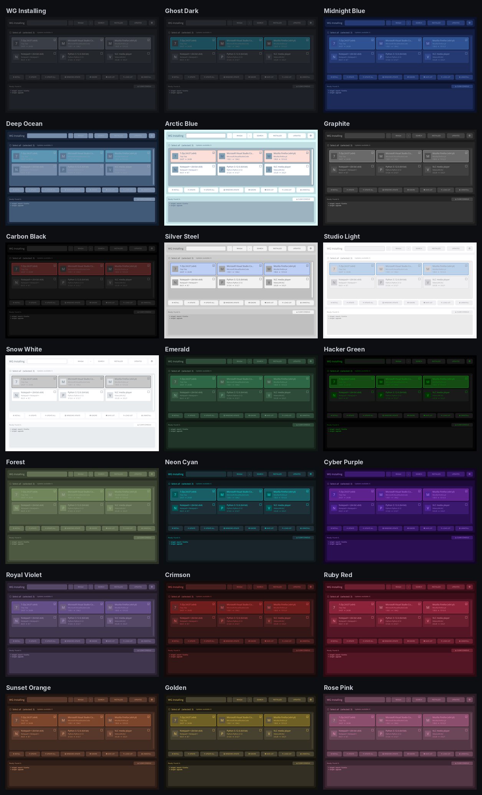

## 📖 Zo werkt het, stap voor stap

🟥 Een rood kader toont **waar je klikt**. 🔴 De nummers **1**, **2**, **3** tonen **wat je eerst klikt**.

### 📥 Stap 1. Downloaden

Klik bovenaan deze pagina op de groene knop **Download**. Je browser downloadt één bestand: **WG-Installing.exe**.

### 📂 Stap 2. Open het gedownloade bestand

- Klik op het gedownloade bestand in de **rechterbovenhoek** van je browser,
- of open de map **Downloads** en dubbelklik op **WG-Installing.exe**.

> 💡 **Tip:** sleep het bestand van *Downloads* naar je **Bureaublad**. Dan vind je het de volgende keer meteen.

### 🛡️ Stap 3. Een blauw venster? Geen probleem

De eerste keer kan Windows een blauw venster tonen: *‘Uw pc is beveiligd door Windows’*.
Dat is normaal bij kleine, gratis programma's.

1. Klik op **Meer informatie**.
2. Klik op **Toch uitvoeren**.

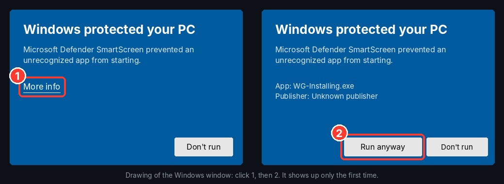

### ✅ Stap 4. Windows vraagt toestemming: klik op ‘Ja’

Het scherm wordt even donkerder en Windows vraagt: *‘Wilt u toestaan dat deze app wijzigingen aanbrengt op uw apparaat?’*.
Klik op **Ja**. Zo hoeft het programma niet bij elke installatie opnieuw te vragen.

> 🔧 De eerste keer controleert het programma of je computer alles heeft wat nodig is.
> Ontbreekt er iets, dan vraagt het: *‘Install them automatically now?’*. Klik op **Ja** en het downloadt het van de officiële sites.

✅ Het programma draait!

## 🖱️ Deel 2. Installeren, bijwerken, verwijderen

### 🔎 Stap 5. Een nieuw programma installeren

**Zoek eerst het programma:**

1. Typ bovenaan de naam, bijvoorbeeld `firefox`, `vlc` of `7zip`.
2. Klik op **SEARCH** (of druk op Enter).

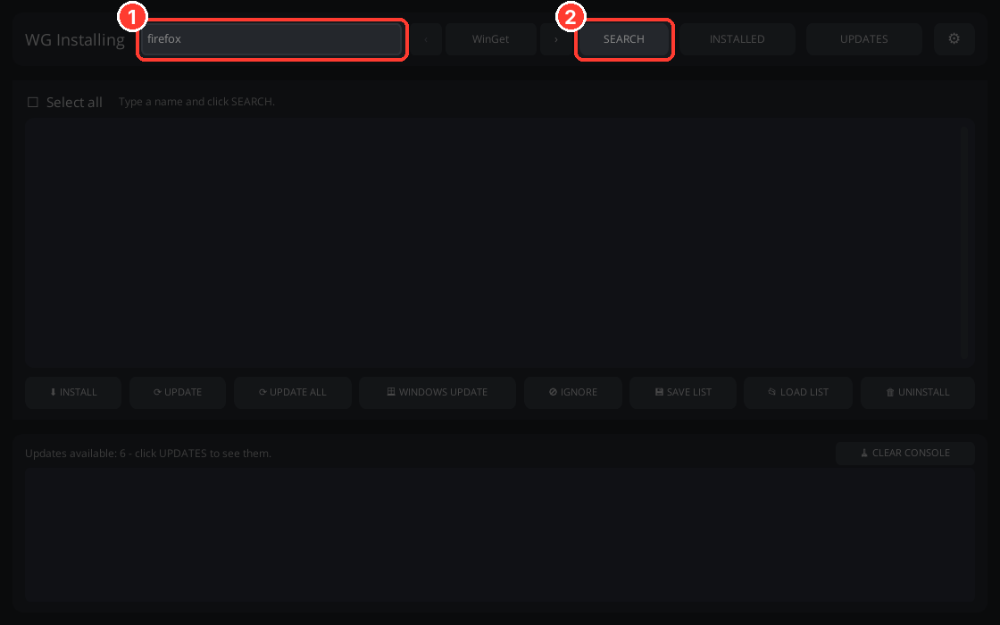

**Installeer het dan:**

1. Klik op de tegel van het gewenste programma. In de hoek verschijnt een ✔.
2. Klik onderaan op **INSTALL**.

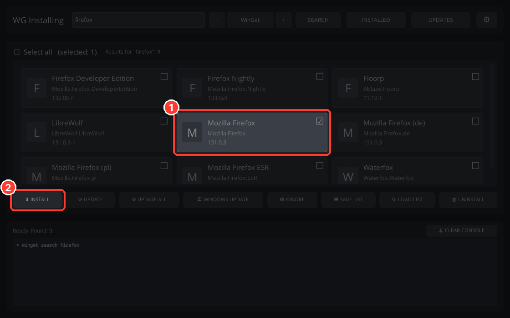

Het programma vraagt of je het zeker weet. Klik op **Ja** en wacht. De voortgang zie je in het zwarte vlak onderaan.

> 💡 Je kunt meerdere tegels tegelijk aanvinken. Ze worden na elkaar geïnstalleerd.

### ⬆️ Stap 6. Werk je programma's bij (één keer per week is top)

1. Klik bovenaan op **UPDATES**. Je ziet de programma's met een nieuwere versie.
2. Klik op **UPDATE ALL**.

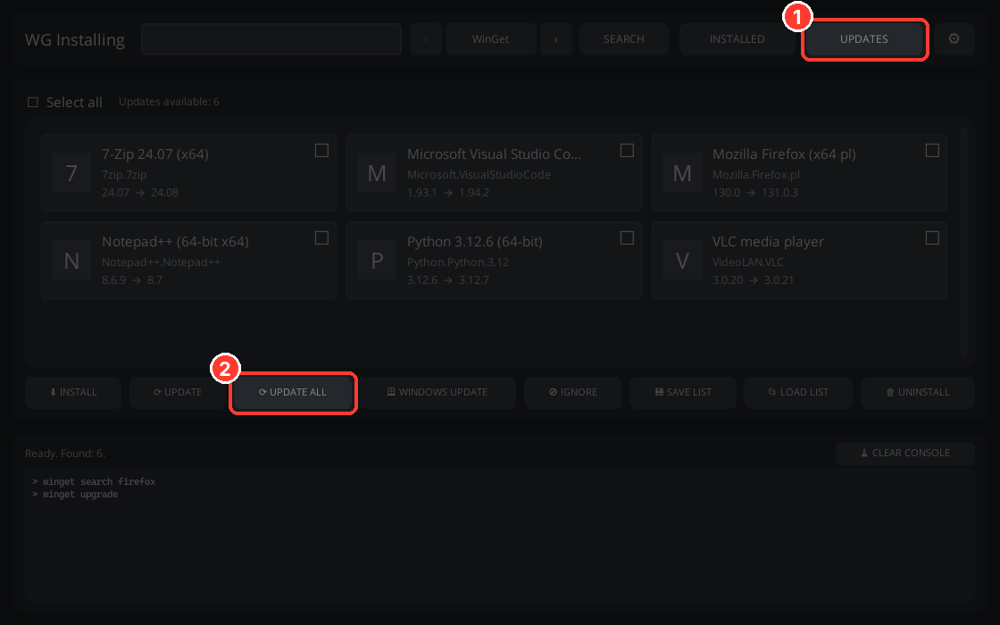

Elke tegel toont de oude en de nieuwe versie, bijvoorbeeld **24.07 → 24.08**.

> 💡 Maar één programma bijwerken? Vink de tegel aan en klik op **UPDATE**. 
> Een programma nooit bijwerken? Vink het aan en klik op **IGNORE**.

### 🗑️ Stap 7. Een programma verwijderen dat je niet meer wilt

1. Klik bovenaan op **INSTALLED**. Je ziet de programma's op je computer.
2. Klik op de tegel van het programma dat weg moet.
3. Klik op **UNINSTALL**.

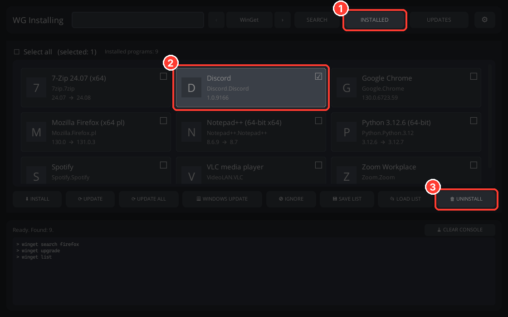

Het programma vraagt *‘Really UNINSTALL?’*. Klik alleen op **Ja** als je het zeker weet.

---

## ⚙️ Deel 3. Instellingen

Klik op **⚙** in de rechterbovenhoek.

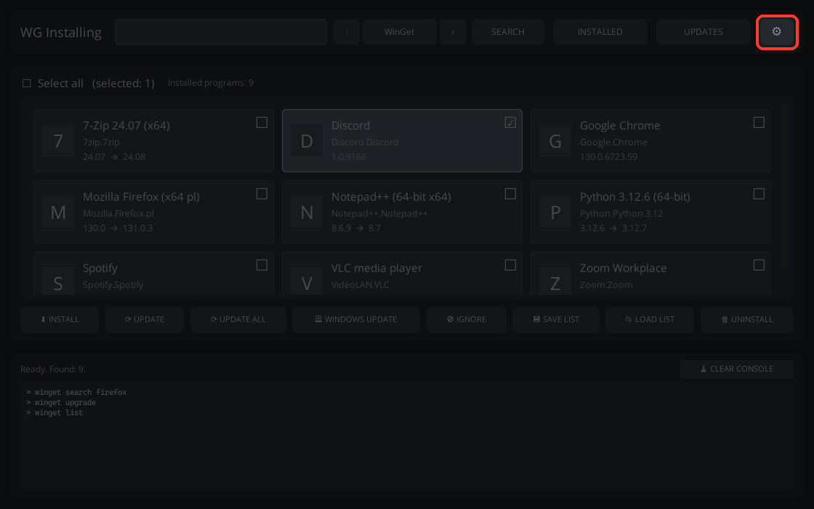

1. **Taal:** 7 talen. Klik op de pijlen **‹ ›** tot je de jouwe ziet.
2. **Uiterlijk:** 21 kleurthema's. Klik tot je het mooi vindt.
3. **Als administrator uitvoeren:** staat het aan, dan vraagt Windows maar één keer bij het starten (Stap 4).

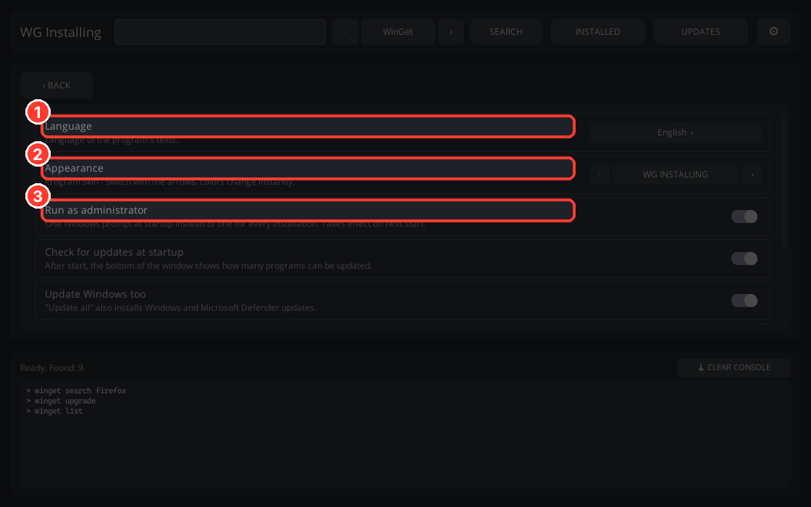

Verder naar beneden: op updates controleren bij het starten, Windows-updates, de lijst genegeerde programma's en de licentie.
Terug ga je met **‹ BACK**.

---

## ✨ Deel 4. Extra's

### 💾 Nieuwe computer? Neem je programma's mee

1. Klik op de **oude** computer op **SAVE LIST** en sla het bestand op (bijvoorbeeld op een usb-stick).
2. Klik op de **nieuwe** computer op **LOAD LIST** en kies dat bestand.

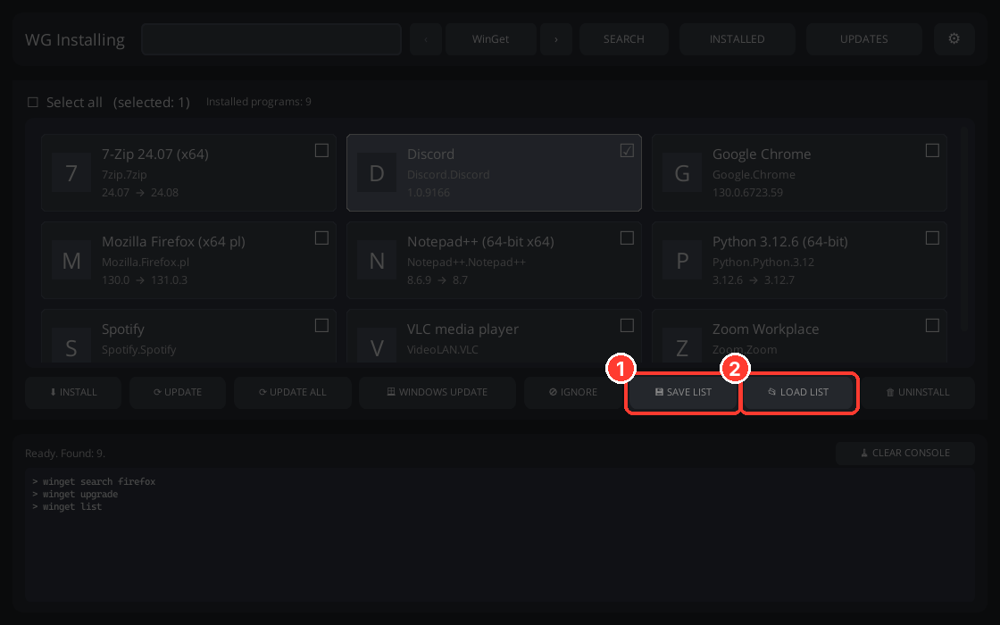

Alle programma's installeren zichzelf. Wat je al hebt, wordt overgeslagen.

### 🪟 Windows-updates

Klik op **WINDOWS UPDATE**. Het programma toont welke Windows-updates wachten en vraagt eerst voordat het iets installeert.

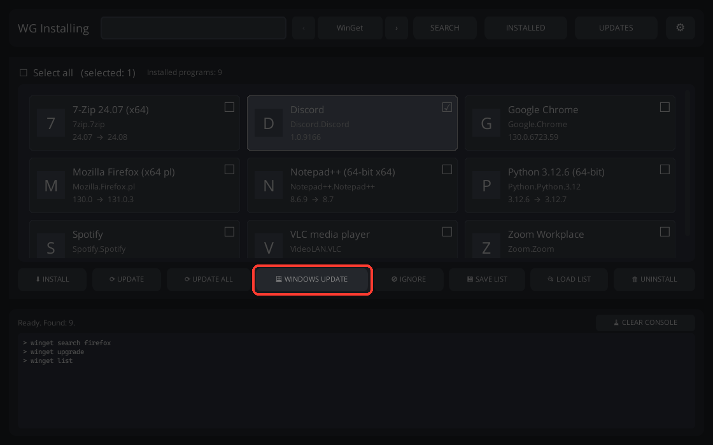

### 🔀 Andere appwinkels

De pijlen **‹ WinGet ›** bovenaan veranderen waar het programma apps vandaan haalt:
**WinGet**, **Microsoft Store**, **PowerShell Gallery**, **Pip**, **Chocolatey**, **Scoop** en **Ninite**.
De knoppen werken overal hetzelfde. Twijfel je, laat het dan op **WinGet**.

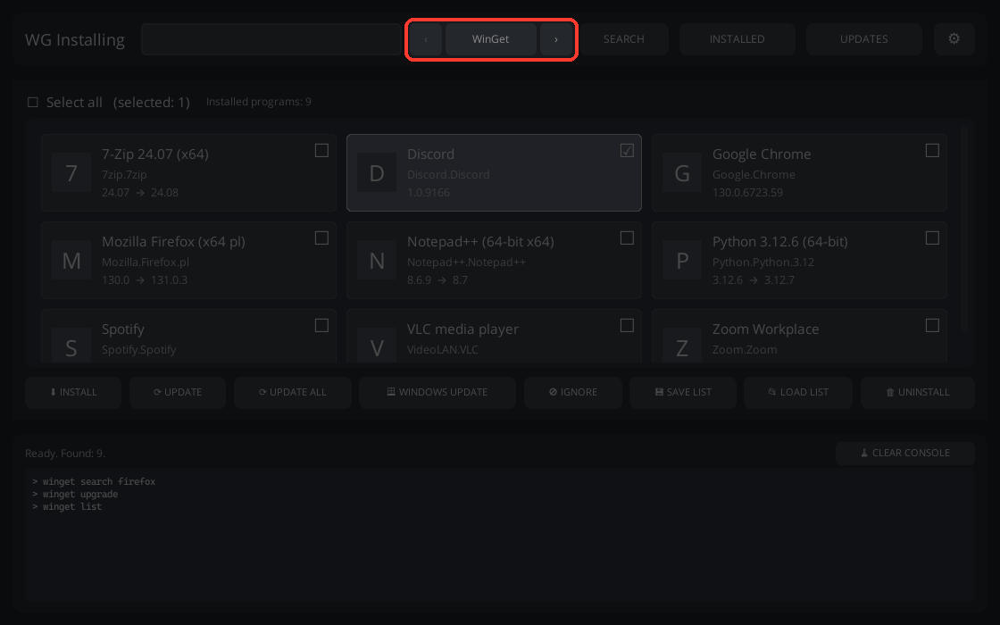

## 🆘 Werkt er iets niet?

| Wat ik zie | Wat te doen |
|---|---|
| Blauw venster *‘Uw pc is beveiligd door Windows’* | **Meer informatie** → **Toch uitvoeren**. Zie Stap 3 hierboven. |
| De browser zegt dat het bestand *‘niet vaak wordt gedownload’* | Klik op **⋯** naast het bestand → **Behouden** → **Meer weergeven** → **Toch behouden**. |
| Mijn antivirus waarschuwt | Dat is gebruikelijk bij kleine programma's zonder betaalde handtekening. Programma's worden geïnstalleerd door winget, de eigen tool van Microsoft. |
| *"winget was not found"* | Installeer **App-installatieprogramma** uit de Microsoft Store, of klik op **Ja** als het programma aanbiedt het te installeren. |
| Het scherm wordt bij elke start donker | Dat is Windows die toestemming vraagt. Zet het uit in **⚙** → *Als administrator uitvoeren*. |
| Een tegel toont een letter in plaats van een plaatje | Het plaatje wordt op de achtergrond gedownload. Wacht even; er is internet nodig. |
| Het starten duurt even | Het pakt zichzelf eerst een paar seconden uit. Dat is normaal. |
| Ik wil de instellingen terug naar nieuw | Sluit het programma. Typ `%APPDATA%` in de adresbalk van de map en verwijder de map **WG Installing**. |

Kom je er niet uit? Schrijf op GitHub: [github.com/MRGREGOR85](https://github.com/MRGREGOR85)

## Is het veilig?

WG Installing bevat zelf geen programma's. Het gebruikt <b>winget</b>, de officiële tool van Microsoft, of de bron die jij kiest. Het vraagt altijd eerst voordat het iets installeert, bijwerkt of verwijdert.

## Licentie

Gratis voor privé- en niet-commercieel gebruik. Verkoop of commercieel gebruik alleen met toestemming van de maker.
Volledige tekst: [PolyForm Noncommercial 1.0.0](../LICENSE).

WG Installing is een onafhankelijk programma en is niet gemaakt door Microsoft.

## 🎬 YouTube

<a href="https://youtu.be/-S9qmIzon4g">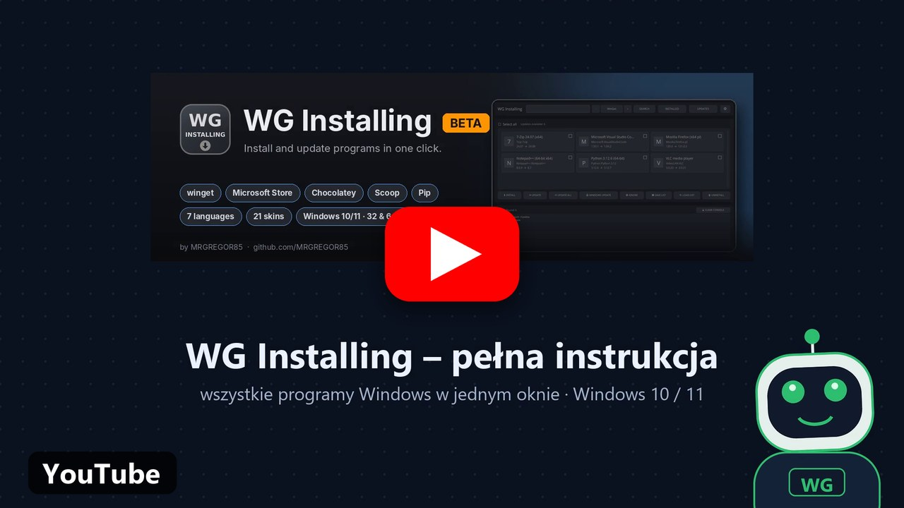</a>

## Maker

**MRGREGOR85** · [github.com/MRGREGOR85](https://github.com/MRGREGOR85)

Helpt WG Installing je? Geef het dan een ⭐
